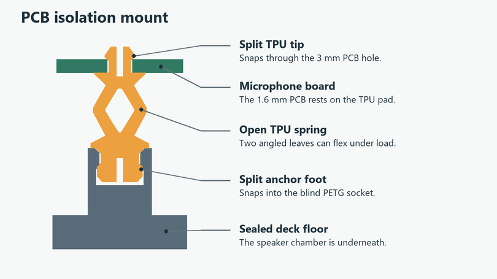

# TPU mounts for the ReSpeaker microphone board

This deck uses four removable TPU snap mounts. Each has a split foot that locks in a blind PETG socket, an open diamond spring and a split tip that catches the top of the PCB. The PCB stays at its original nominal height. The speaker body, base, chamber seal and deck fasteners fit either deck.



## Print and fit

1. Print the small gauge in PETG and five upright mounts in 95A TPU. Four are installed and one is a spare. The H2S project uses a 0.4 mm nozzle and 0.16 mm layers for the TPU. Remove the outer brim and any strands in the two splits or spring window.
2. Try the TPU tip through the gauge's 1.6 mm ear, which has a nominal 3 mm hole. Press the opposite end into the socket until its collar seats on the rim. The upper tip should recover, the foot should stay seated under a gentle tug, and the spring should flex and return. The actual PCB is the final fit check. If the tip needs force, squeeze its two halves together for insertion. For removal, squeeze them before lifting the board.
3. Print the isolated deck in PETG. Snap the four mounts into the deck, align the PCB microphones up and press the board down beside each hole while supporting the TPU pad. The PCB fasteners are the four TPU tips. Keep the six deck-to-body screws.
4. Check that all four shoulders support the PCB and that the rim, plugs and USB/Ethernet overmolds clear it with the cables in place. Give the speaker lead a slack loop between the sealed feedthrough and PCB. A taut lead or cable boot touching the deck can transmit vibration around the mounts.

The original design gave the stacked USB housing 0.7 mm of nominal vertical clearance above its sill. The new opening is 42 mm wide and runs to the top of the sealed deck floor. That gives 1.7 mm at nominal board height. Loaded sag, retention, creep and vibration attenuation still need a physical test. To compare microphone pickup, record the same playback sweep on both decks at the same gain, volume, placement and cable routing.

## Dimensions and files

| Feature | Nominal dimension |
| --- | ---: |
| Board underside above the deck floor surface | 17.0 mm |
| Board mounting hole and board thickness | 3.0 mm and 1.6 mm |
| Split PCB tip at its widest point | 3.6 mm diameter |
| Socket throat and anchor bead | 4.9 mm and 5.4 mm diameter |
| Deck floor thickness | 4.0 mm |

Printable meshes are [the PETG deck](out/isolated-deck.stl), [one TPU mount](out/tpu-mount.stl) and [the PETG fit gauge](out/socket-gauge.stl).

The editable variant uses the original `out/deck.stl` as its input. Open the source in OpenSCAD and set `part` to `assembly` or `section` to inspect it. To regenerate the three meshes, run the following commands from the enclosure directory.

```sh
openscad --export-format binstl -D 'part="deck"' -o out/isolated-deck.stl pcb-isolation.scad
openscad --export-format binstl -D 'part="mount"' -o out/tpu-mount.stl pcb-isolation.scad
openscad --export-format binstl -D 'part="gauge"' -o out/socket-gauge.stl pcb-isolation.scad
```
